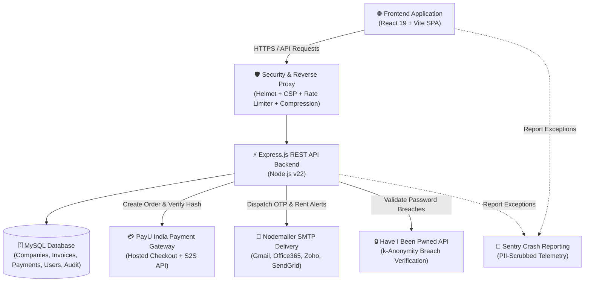
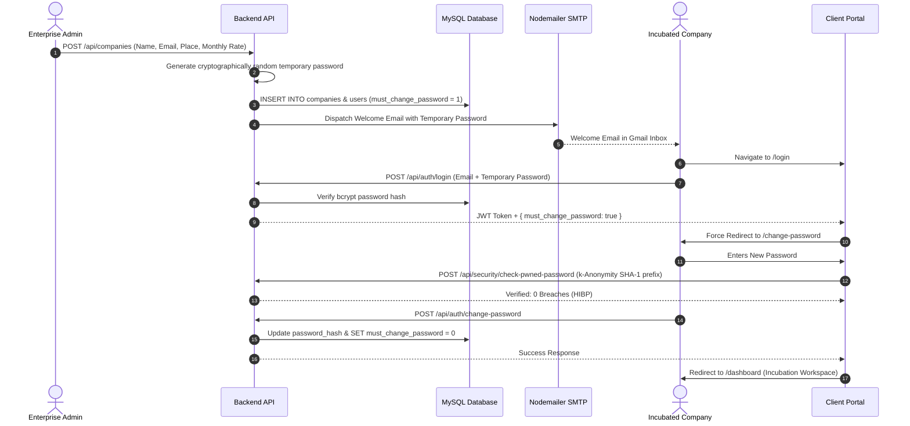
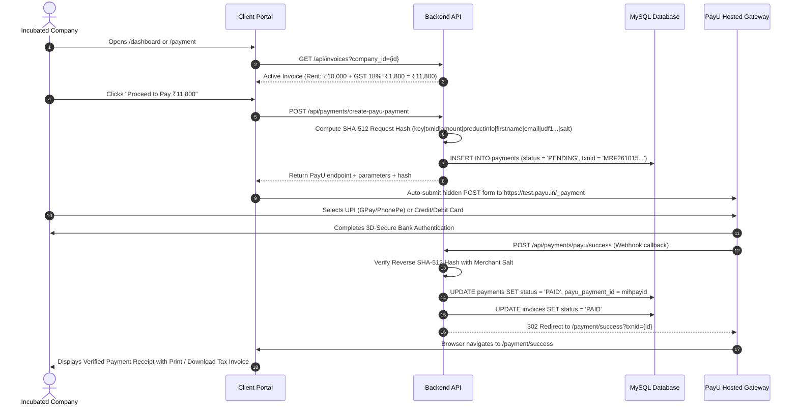
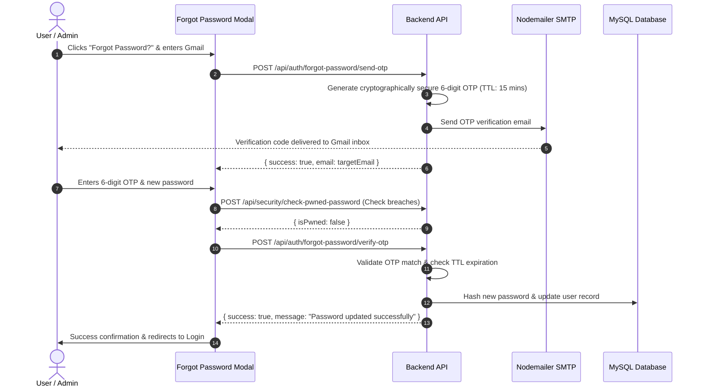
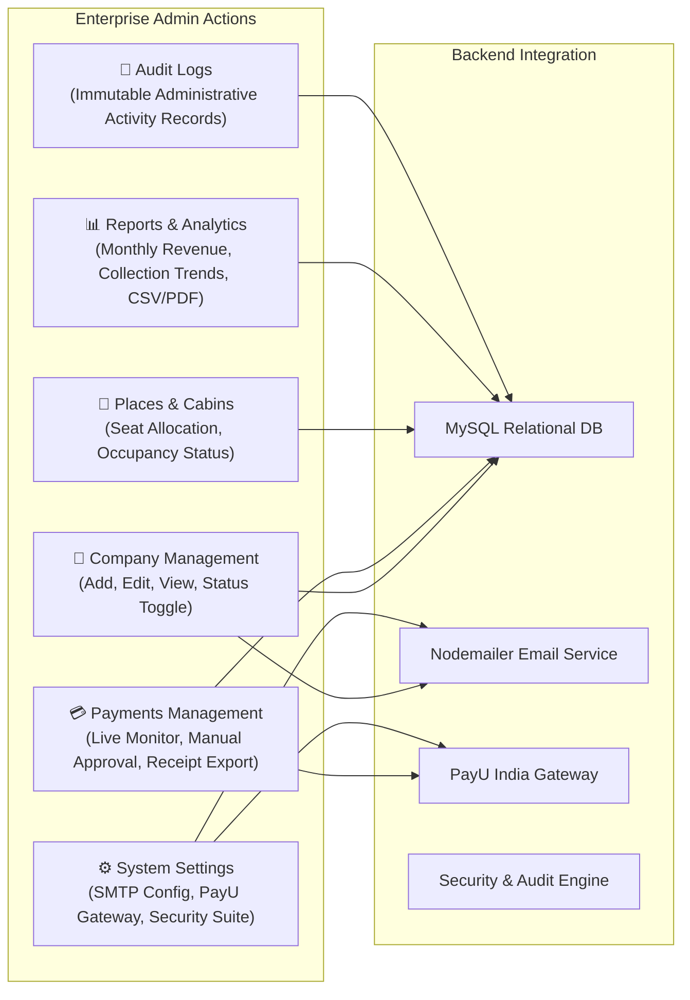
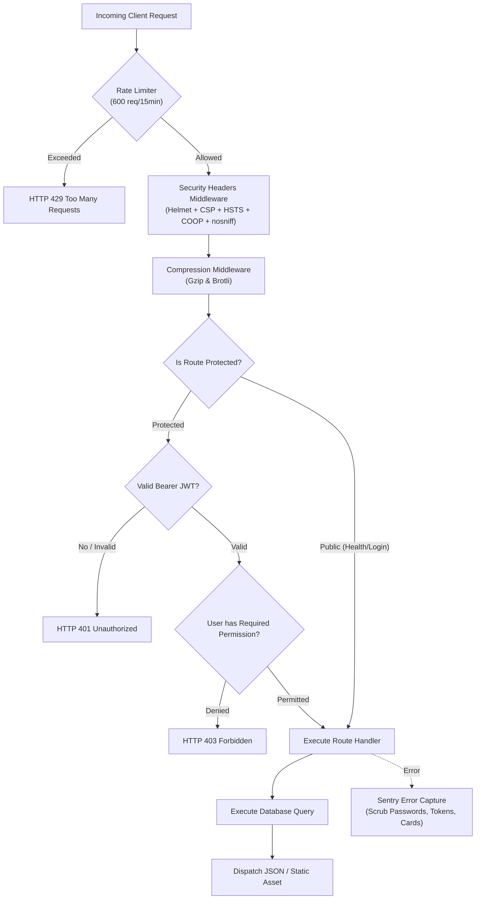
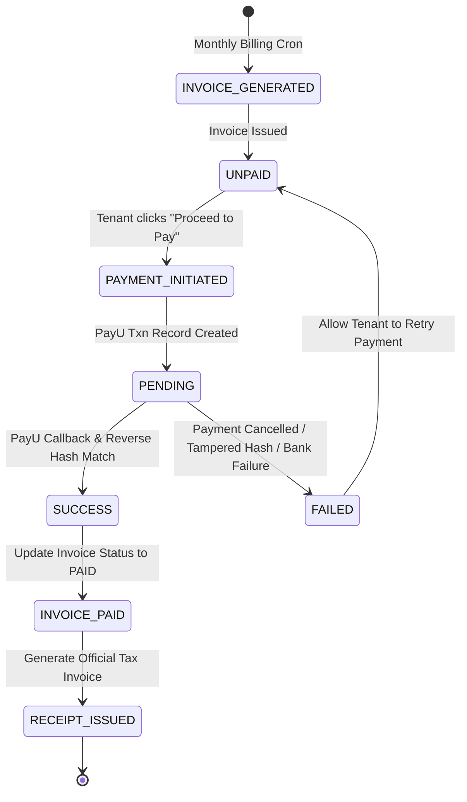

# MCC MRF Innovation Park — End-to-End Portal Workflow Architecture

This document outlines the complete operational, security, and data flow of the **MCC MRF Innovation Park Incubation & Rental Management Portal**.

---

## 📑 Table of Contents
1. [High-Level Architecture Overview](#1-high-level-architecture-overview)
2. [User Personas & Role Matrix](#2-user-personas--role-matrix)
3. [Workflow 1: Incubated Company Onboarding & First-Time Login](#workflow-1-incubated-company-onboarding--first-time-login)
4. [Workflow 2: Monthly Billing & PayU Payment Processing](#workflow-2-monthly-billing--payu-payment-processing)
5. [Workflow 3: Forgot Password & Gmail OTP Recovery](#workflow-3-forgot-password--gmail-otp-recovery)
6. [Workflow 4: Enterprise Admin & Operational Management](#workflow-4-enterprise-admin--operational-management)
7. [Workflow 5: Production Security & Compliance Verification](#workflow-5-production-security--compliance-verification)
8. [Database State Machine & Payment Lifecycle](#8-database-state-machine--payment-lifecycle)

---

## 1. High-Level Architecture Overview

---

## 2. User Personas & Role Matrix

| Role | Access URL | Permissions & Capabilities |
| :--- | :--- | :--- |
| **Incubated Company** | `/login`, `/dashboard` | View incubator space, invoice breakdown, rent payment via PayU, download official GST tax receipts, update account profile. |
| **Enterprise Admin** | `/Novara_admin`, `/admin/dashboard` | Manage incubated companies, oversee payments, manage places/workstations, dispatch email rent alerts, generate reports, configure system settings. |
| **Super Admin** | `/Novara_admin`, `/admin/*` | Full system control, role permissions management, SMTP credential configuration, access control audit logs. |

---

## Workflow 1: Incubated Company Onboarding & First-Time Login

### Steps:
1. **Onboarding**: Admin creates company profile in **Admin > Companies**.
2. **Credential Generation**: Cryptographically secure temporary password (e.g. `Mrf@2026#X7pL`) is generated.
3. **Dispatch**: Notification dispatched to company's registered email.
4. **First Login Guard**: Login response flags `must_change_password: true`.
5. **Breach Check**: Tenant chooses a new password. The portal verifies in real-time that it complies with 5 security rules and does not exist in the 800M+ **Have I Been Pwned** breach database.
6. **Access Granted**: Password hash updated in database, user enters Company Dashboard.

---

## Workflow 2: Monthly Billing & PayU Payment Processing

### Steps:
1. **Invoice Due**: The portal loads the company's active monthly invoice.
2. **Order Initiation**: Server creates a pending transaction record with a unique transaction ID (`txnid`) and calculates the official PayU SHA-512 hash.
3. **Hosted Gateway**: User seamlessly transitions to PayU's hosted checkout to complete payment using UPI or Cards.
4. **Reverse Hash Verification**: PayU returns transaction parameters to `/api/payments/payu/success`. The backend verifies the cryptographic reverse hash using the private merchant salt.
5. **State Finalization**: Both payment record and invoice are marked as `PAID`.
6. **Receipt**: Tenant views and prints their official GST invoice receipt.

---

## Workflow 3: Forgot Password & Gmail OTP Recovery

---

## Workflow 4: Enterprise Admin & Operational Management

---

## Workflow 5: Production Security & Compliance Verification

---

## 8. Database State Machine & Payment Lifecycle

---

## 🛠️ Summary of Key Endpoints & Route Handlers

| Endpoint | Method | Role Required | Description |
| :--- | :--- | :--- | :--- |
| `/api/auth/login` | `POST` | Public (Rate Limited) | User and Company authentication gateway. |
| `/api/auth/forgot-password/send-otp` | `POST` | Public (Rate Limited) | Sends 6-digit verification code to registered email. |
| `/api/auth/forgot-password/verify-otp` | `POST` | Public (Rate Limited) | Verifies OTP and resets password with HIBP check. |
| `/api/auth/change-password` | `POST` | Authenticated | Updates temporary password to permanent password. |
| `/api/payments/create-payu-payment` | `POST` | Authenticated | Generates SHA-512 PayU checkout session. |
| `/api/payments/payu/success` | `POST` | Public (PayU Callback)| Validates reverse hash and marks invoice as PAID. |
| `/api/payments/payu/failure` | `POST` | Public (PayU Callback)| Handles bank cancellation and failed payments. |
| `/api/security/headers-audit` | `GET` | Public / Admin | Returns live SSL Labs and Security Headers audit. |
| `/api/security/check-pwned-password` | `POST` | Public (Rate Limited) | Checks password against 800M+ Have I Been Pwned breaches. |
| `/api/security/virustotal/scan-url` | `POST` | Admin | Real-time threat scanning of URLs across 70+ engines. |
| `/api/analytics/web-vitals` | `POST` | Public (Beacon) | Real-user Core Web Vitals telemetry collector. |
| `/api/health` | `GET` | Public (Unthrottled) | Pingdom 24/7 server and database health probe. |
